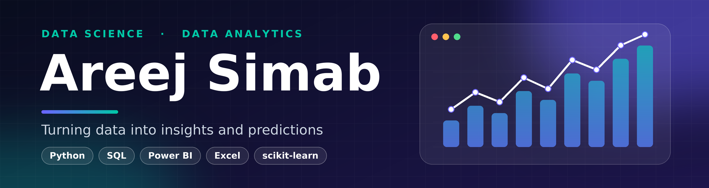
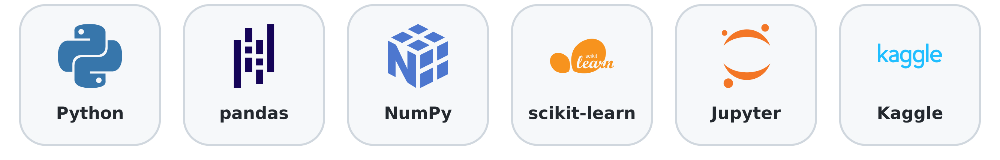
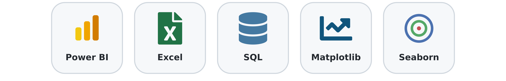
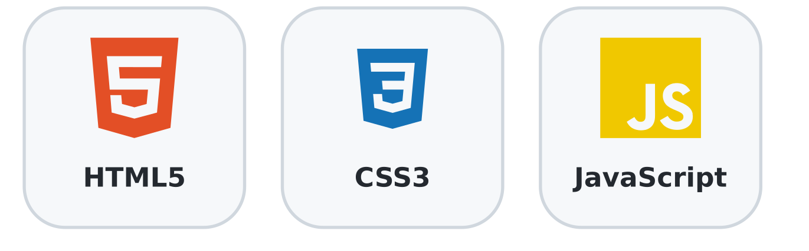
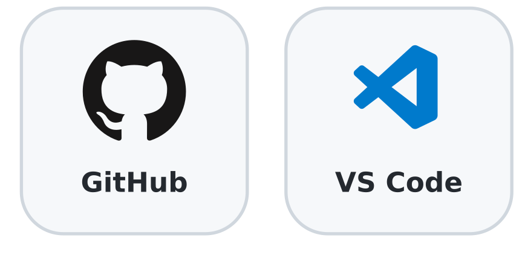

  

  

<b>
<a href="#-about-me">About</a> &nbsp;•&nbsp;
<a href="#-what-i-do">What I Do</a> &nbsp;•&nbsp;
<a href="#-how-i-work">How I Work</a> &nbsp;•&nbsp;
<a href="#-skills">Skills</a> &nbsp;•&nbsp;
<a href="#-projects">Projects</a> &nbsp;•&nbsp;
<a href="#-roadmap">Roadmap</a> &nbsp;•&nbsp;
<a href="#-connect">Connect</a>
</b>

---

## 👋 About Me

**Hi, I'm Areej!** I'm a **BSc (Hons) Computer Science student** with a passion for data, technology and problem solving.

My main focus is **data science and data analytics**: cleaning and exploring data, building dashboards in **Power BI**, and training machine learning models in **Python**. Alongside that, I enjoy software development, from desktop applications to websites, and I'm exploring cloud technologies to understand how modern systems are built and run.

I learn best by building practical things, and I care about results that are clear, honest and easy to explain.

- 🎓 **Studying:** BSc (Hons) Computer Science
- 📊 **Main focus:** data analytics, visualisation and machine learning
- 💻 **Also enjoy:** building applications and websites
- ☁️ **Exploring:** Advanced Machine Learning
- 🌱 **Learning next:** feature engineering, cross-validation and time-series models
- 🤝 **Open to:** collaboration and learning opportunities in data science and analytics

---

## 💡 What I Do

- 📊 **Data analysis & visualisation:** turning raw data into clear charts and findings that people can act on
- 🤖 **Machine learning:** building and evaluating predictive models in Python, from classification to regression
- 📈 **Dashboards & business intelligence:** presenting sales and performance data in interactive Power BI dashboards
- 🧹 **Data preparation:** cleaning, checking and structuring messy data so the analysis can be trusted
- 💻 **Software & web development:** building practical applications and websites
  

---

## 🧭 How I Work

- 🎯 **Start simple:** I compare any model or solution with a simple baseline, so I know whether the extra complexity is worth it.
- 🧪 **Test fairly:** I evaluate results on data that was not used for training or tuning.
- 🧹 **Check the data first:** missing values, duplicates and odd values come before any analysis.
- 📝 **Explain clearly:** I document my work and explain results in plain language, including the limitations.
- 🔁 **Keep improving:** I finish each piece of work by noting what I would do next.

---

## 🛠️ Skills

**Data Science & Machine Learning**

**Data Analytics & Visualisation**

**Programming & Web**

**Tools & Platforms**

---

## 🚀 Projects

### 🧠 Data Science & Machine Learning
- 🚢 **Titanic Survival Classification:** predicts which passengers survived from age, sex, ticket class and fare (79.9% test accuracy). Built with Python, pandas and scikit-learn. [View the repository](https://github.com/AreejSimab/titanic-survival-classification)
- 📈 **Apple Stock Price Prediction:** predicts the next day's closing price using a time-based split and compares the model with a simple baseline. Built with Python, pandas and scikit-learn. [View the repository](https://github.com/AreejSimab/stock-price-prediction)

### 📊 Data Analytics & Business Intelligence
- 🛒 **Retail Analytics Dashboard:** Power BI dashboard that turns sales and inventory data into insights.

### 💻 Software & Web Development
- 🏎 **Car Racing Event Management System:** desktop application for managing race events and participants.
- 🌐 **ABC Supermarket Website:** front-end e-commerce website for a supermarket.

### ☁️ Cloud
- ☁️ **Cloud Computing Labs:** hands-on exercises building and managing cloud infrastructure.

<!-- Add a link to each repo here once it is uploaded -->

👉 See everything on my [repositories page](https://github.com/AreejSimab?tab=repositories).

---

## 🗺 Roadmap

- [x] Data cleaning, exploration and visualisation
- [x] Classification and regression models in Python
- [x] Business dashboards in Power BI
- [x] Desktop and web application development
- [x] Hands-on cloud labs
- [ ] Feature engineering and cross-validation
- [ ] More models: Random Forest and gradient boosting
- [ ] Time-series forecasting with LSTM
- [ ] Advanced SQL analytics and more dashboards
- [ ] Deeper cloud skills

---

## 📊 Stats

 

<!-- Snake animation: needs the workflow in .github/workflows/snake.yml to run once -->
<picture>
  <source media="(prefers-color-scheme: dark)" srcset="https://raw.githubusercontent.com/AreejSimab/AreejSimab/output/github-snake-dark.svg"/>
  <source media="(prefers-color-scheme: light)" srcset="https://raw.githubusercontent.com/AreejSimab/AreejSimab/output/github-snake.svg"/>
  
</picture>

---

## 📫 Connect

Have a data project, an idea, or feedback on my work? I'd love to hear from you.

<i>Thanks for visiting! ⭐ If you like a project, feel free to star the repo.</i>

